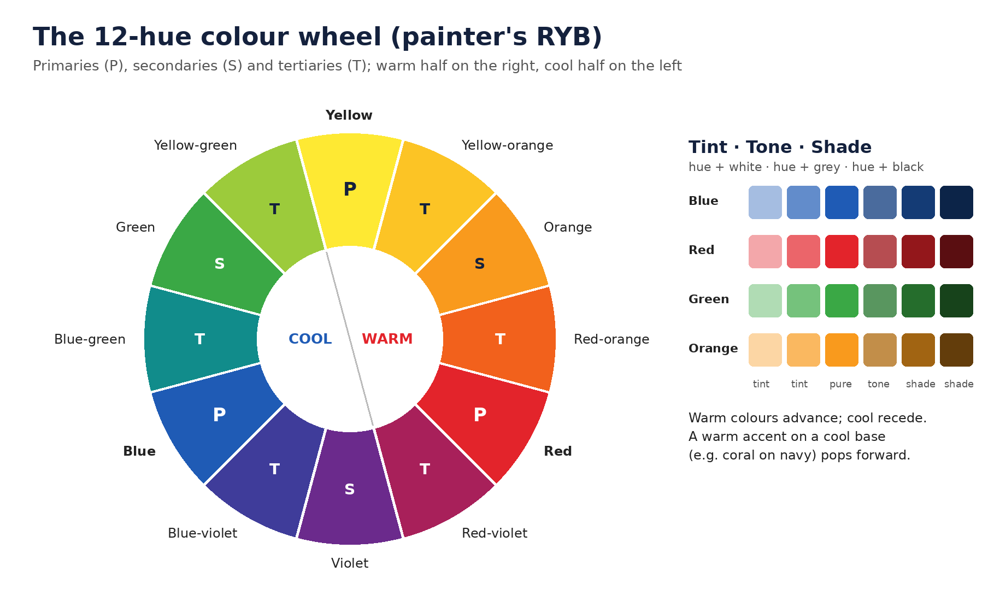
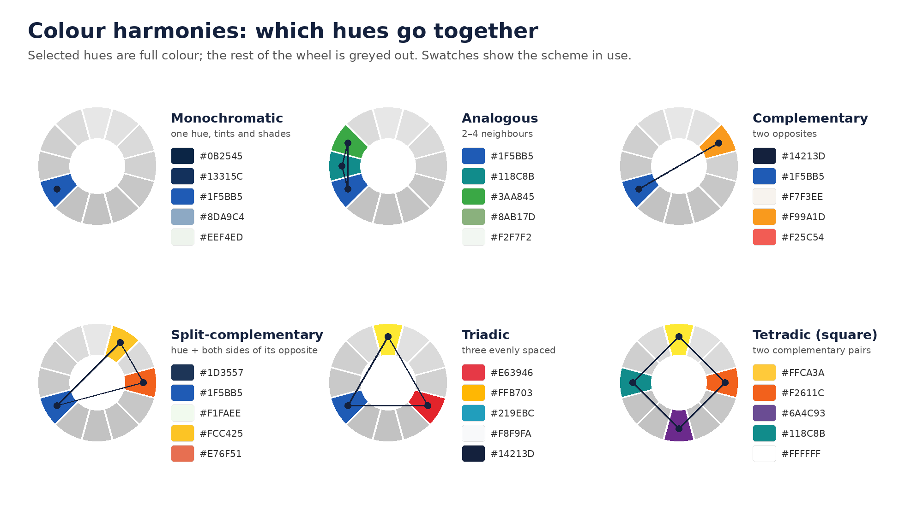

# 5. Colour

Build a small, named palette with one dominant colour, check every text pairing against WCAG contrast, never carry meaning by colour alone, and treat colour-psychology claims with caution: colour meaning is real but depends heavily on context and culture.

### 5.1 Colour science essentials

- **Additive (RGB)** colour is light: screens, mixing to white. **Subtractive (CMYK)** colour is ink: print, mixing towards black. Screen colours, especially bright greens, oranges and blues, often cannot be printed (out of gamut).
- **Three dimensions:** hue (the colour family), saturation or chroma (intensity), and value or lightness (how light or dark). Hierarchy depends mostly on **value**; that is why the grayscale test works.
- **Colour spaces:** sRGB (web and social default), Display P3 (wider, modern phones and Macs), Adobe RGB (photography), CMYK profiles such as FOGRA39/51 or GRACoL (print), CIELAB and **OKLCH** (perceptually uniform).
- **Use OKLCH or LAB to build palettes.** HSL is not perceptually uniform: a yellow and a blue at the same HSL lightness look very different. Oklab/OKLCH (Ottosson, 2020) fixes this, gives smoother gradients and tint ramps, and is supported in CSS Color 4 ([Wikipedia summary](https://en.wikipedia.org/wiki/Oklab_color_space)). **\[Standard\]**
- **Simultaneous contrast:** a colour looks different depending on its neighbours (Albers, *Interaction of Color*). Always judge colour in the final composition and on the target device.

### 5.2 Building a palette

| Role | Share of visual area | Notes |
| --- | --- | --- |
| Dominant (often a neutral or brand base) | \~60% | Backgrounds, large fields |
| Secondary | \~30% | Panels, cards, supporting shapes |
| Accent | \~10% or less | Calls to action, key numbers, labels; if everything is accent, nothing is |
| Neutrals | As needed | Text, dividers; tint them slightly towards the brand hue rather than pure grey |
| Functional | Sparingly | Success, warning, error; never reuse the brand accent for error states |

- The 60-30-10 split is a **\[Practice\]** starting point, not a law.
- Build each colour as a ramp of 9–11 steps (e.g. 50–950) of equal perceptual lightness steps, so tints and shades stay consistent.
- **Avoid pure black (#000) on pure white** for long text on screens; use a very dark neutral (e.g. #14213D-like navies or #1A1A1A) to reduce glare while keeping contrast high.
- Limit fully saturated colours to one or two; saturation competes for attention.

### 5.3 Harmony schemes

| Scheme | Construction | Character | Use |
| --- | --- | --- | --- |
| Monochromatic | One hue, varied lightness and chroma | Calm, cohesive, premium | Corporate, luxury, minimal |
| Analogous | Neighbouring hues (within \~30–60°) | Natural, harmonious | Lifestyle, wellness |
| Complementary | Opposite hues | High energy, strong contrast | Calls to action, sport, sales |
| Split-complementary | Base + two neighbours of its complement | Contrast with less tension | General marketing |
| Triadic | Three hues 120° apart | Playful, vivid | Children, entertainment; mute two of them |
| Navy + warm accent (e.g. navy and coral) | Dark cool base + one warm accent | Trustworthy yet approachable | Professional services, finance, property |

### 5.4 Colour psychology: what the evidence supports

- **Associations are real and largely shared across cultures.** A 30-nation study of 4,598 people, including Nigerian participants, found colour–emotion patterns in each country correlated r = .88 with the global pattern: black with sadness, fear and hate; red with love and anger; yellow and orange with joy; pink with love and pleasure; grey with sadness; white with relief. Language and geography shaped the remaining differences ([Jonauskaite et al., Psychological Science 31(10), 2020](https://biopen.bi.no/bi-xmlui/bitstream/11250/2761614/1/Jonauskaite_etal_2020_PsychScience.pdf)). **\[Research\]**
- **Preferences track the objects colours remind us of.** Palmer and Schloss’s ecological valence theory explained 80% of variance in colour preference by the appeal of objects with those colours: blues (clear sky, clean water) liked; browns and olive yellows (decay) disliked; saturated colours preferred to muted ([PNAS 107(19), 2010](https://palmerlab.berkeley.edu/pdf/Palmer%26Schloss%282010%29.pdf)). **\[Research\]**
- **Colour shapes brand personality.** Labrecque and Milne showed hue, saturation and value shift perceived brand personality and purchase intent (“exciting red and competent blue”) ([Journal of the Academy of Marketing Science 40, 2012](https://link.springer.com/content/pdf/10.1007/s11747-010-0245-y.pdf)). **\[Research\]**
- **But effects are context-dependent and the field is young.** Elliot’s review calls colour psychology “at a nascent stage of development” and urges “patience and prudence” before applying findings ([Frontiers in Psychology 6:368, 2015](https://www.frontiersin.org/articles/10.3389/fpsyg.2015.00368/text)). Red can signal danger in an exam setting and attraction in a dating setting. **\[Research\]**
- **Zombie statistic warning:** the widely quoted claim that “62–90% of product judgements are based on colour alone” appears in Singh (2006) without any citation or supporting data ([Management Decision 44(6)](https://newion.uwinnipeg.ca/~ssingh5/x/color.pdf)). **MUST NOT** be quoted as fact.

**Working associations (use as hypotheses, test with your audience):**

| Colour | Common associations | Watch out for |
| --- | --- | --- |
| Navy / dark blue | Trust, competence, stability, finance, professional services | Can feel cold or generic without a warm accent |
| Light blue | Calm, health, clean, technology | Low contrast with white text |
| Red | Energy, urgency, love, danger, appetite | Overuse reads as alarm; error states |
| Coral / warm orange | Approachable, friendly, optimistic | Fails contrast as small text on white |
| Yellow / gold | Joy, optimism, value; gold for premium | Yellow text on white is illegible; mustard/olive tones disliked |
| Green | Growth, money, health, sustainability; Nigerian national colour | Red-green pairs fail for colour-blind viewers |
| Purple | Luxury, creativity, royalty | Can feel dated if over-saturated |
| Black | Luxury, authority, sophistication; mourning | Heavy if dominant on small screens |
| White | Purity, cleanliness, simplicity; worn at some Nigerian funerals and religious events | Needs structure or it feels unfinished |
| Brown / earth | Natural, reliable, rustic | Least-liked hue family in preference studies |

### 5.5 Colour in the Nigerian context

- In Yoruba, Igbo and Hausa symbolism, **white** signals purity, holiness and sincerity (and is worn at some funerals); **red** signals power, danger, passion and is linked to thunder deities; **black** signals mourning and negative forces ([Adédínà and Táíwò, LASU Journal of African Studies 8, 2020](https://lasujournalofafricanstudies.org.ng/storage/publications/1660418197.pdf)). **\[Research\]**
- **Green and white** carry strong national (and often political or patriotic) associations; use them deliberately, and avoid party colours in neutral commercial work during election periods.
- Aso-ebi and celebration contexts favour bold, saturated, metallic palettes; corporate and professional services favour navy, deep green, gold accents.

### 5.6 Contrast and accessibility (MUST)

- **WCAG 2.2 SC 1.4.3 (AA):** body text at least **4.5:1** against its background; large text (at least 18 pt / 24 px, or 14 pt / 18.5 px bold) at least **3:1**. Ratios are not rounded: 4.499:1 fails. Logos are exempt. Enhanced (AAA) is **7:1** ([W3C](https://w3.org/WAI/WCAG22/Understanding/contrast-minimum.html)). **\[Standard\]**
- **SC 1.4.11:** icons, chart elements, input borders and buttons at least **3:1** against adjacent colours. **\[Standard\]**
- **Text over photographs:** guarantee contrast with a solid panel, a gradient scrim (typically 40–70% black or brand-dark), or a blurred, darkened area; check the worst spot of the image, not the average.
- **Colour-vision deficiency:** about 8% of men and 0.5% of women of Northern European ancestry have red-green deficiency; in Lagos State a study of 2,326 students found **4.8% of males and 0.7% of females** affected ([Oduntan et al., African Health Sciences 19(2), 2019](https://ajol.info/index.php/ahs/article/view/189175)). **\[Research\]** MUST NOT rely on red vs green alone; add labels, icons, patterns or position. Simulate deuteranopia and protanopia before approval.

### 5.7 Colour management

- Design social and web in **sRGB**; export JPG/PNG with the sRGB profile embedded so colours do not shift between apps.
- Print: convert to the printer’s CMYK profile, soft-proof first, and expect bright RGB colours to dull. Specify Pantone (PMS) for logos and brand colours that must match exactly.
- Calibrate monitors for colour-critical work; check final pieces on at least one phone, since most social content is seen there.
- Write brand colours in all needed formats: HEX, RGB, CMYK, Pantone, and OKLCH.

### 5.8 The colour wheel

The colour wheel arranges hues in a circle so relationships between them can be seen and used: colours opposite each other contrast most, neighbours harmonise, and the wheel splits into a warm half and a cool half.

**Two wheels, two purposes.** The traditional painter’s wheel (RYB: red, yellow, blue primaries) is the one taught in art and used for most colour-harmony rules. The light wheel (RGB primaries red, green, blue; complements cyan, magenta, yellow) describes how screens and printing actually mix colour. Use the RYB wheel to choose pleasing combinations; use RGB/CMYK and OKLCH values to produce them accurately (section 5.1).

| Level | Colours (RYB wheel) | How they are made |
| --- | --- | --- |
| Primary | Red, yellow, blue | Cannot be mixed from other paints |
| Secondary | Orange, green, violet | Two primaries mixed |
| Tertiary | Red-orange, yellow-orange, yellow-green, blue-green, blue-violet, red-violet | A primary mixed with a neighbouring secondary |

**Warm and cool.** Reds, oranges and yellows (and their browns) read as warm: energetic, near, appetising, friendly. Blues, greens and violets read as cool: calm, distant, trustworthy, clean. Warm colours appear to advance and cool colours to recede, so a warm accent on a cool base pops forward naturally (the navy-and-coral pairing works for this reason).

**Tints, tones and shades.** Every hue has a family:

- **Tint** = hue + white (lighter, softer: pastels, backgrounds).
- **Tone** = hue + grey (muted, sophisticated, calm).
- **Shade** = hue + black (deeper, richer, more serious: navy, maroon, forest green).

Most professional palettes are built from tones and shades plus one pure accent, not from several fully saturated hues.

### 5.9 Colour harmonies with ready examples

| Harmony | On the wheel | Example palette (HEX) | Feels | Watch out |
| --- | --- | --- | --- | --- |
| Monochromatic | One hue, many tints and shades | #0B2545 · #13315C · #134074 · #8DA9C4 · #EEF4ED | Calm, premium, cohesive | Can go flat; add contrast in value |
| Analogous | 2–4 neighbours | #264653 · #2A9D8F · #8AB17D · #E9C46A | Natural, harmonious | Low contrast; pick one to dominate |
| Complementary | Two opposites | #14213D (navy) + #F25C54 (coral) or #FCA311 (amber) | Energetic, high impact | Never use both at full strength in equal amounts; edges “vibrate” |
| Split-complementary | One hue + the two neighbours of its opposite | #1D3557 · #E63946 · #F4A261 | Lively but balanced | Keep one dominant |
| Triadic | Three hues evenly spaced | #E63946 · #FFB703 · #219EBC | Playful, vivid | Mute two of the three |
| Tetradic / square | Four hues (two complementary pairs) | #6A4C93 · #1982C4 · #8AC926 · #FFCA3A | Rich, festive | Hardest to balance; one dominant, others small |
| Neutral + accent | Greys or beiges + one colour | #111111 · #F1EFE9 · #84C226 | Modern, confident | Accent only on what matters |

### 5.10 What goes with what: pairing guide

| Base colour | Pairs well with | Avoid pairing with | Good for |
| --- | --- | --- | --- |
| Navy | Coral, amber, gold, white, cream, light grey, sky blue | Black (muddy), dark purple | Finance, law, property, consulting |
| Black | White, cream, gold, one bright accent (lime, red, electric blue) | Dark navy or brown (low contrast) | Luxury, fashion, tech, creative agencies |
| White / off-white | Almost anything; especially navy, black, forest green, terracotta | Yellow and pale pastels as text | Clean, healthcare, minimal brands |
| Red | White, black, navy, cream, gold | Green at equal strength (clash, colour-blind fail), pink, orange side by side | Sales, food, urgency, celebration |
| Coral / salmon | Navy, teal, cream, charcoal | Red, bright orange | Friendly professional, lifestyle |
| Orange | Navy, teal, white, charcoal | Red, brown, pink | Energy, youth, food, telecoms |
| Yellow / gold | Navy, black, charcoal, deep green, purple | White as background for yellow text; light grey | Optimism, value, premium (gold) |
| Green (emerald, forest) | Gold, cream, white, navy, blush pink | Red, bright blue at equal strength | Money, growth, health, eco, Nigeria-themed |
| Lime / bright green | Black, charcoal, white, deep navy | Yellow, orange | Tech, sport, youth |
| Teal / turquoise | Coral, cream, navy, gold | Green-blue mixes of similar value | Wellness, travel, fintech |
| Purple | Gold, cream, lavender, grey, green accents | Red, brown | Luxury, beauty, creativity |
| Pink / blush | Burgundy, navy, gold, sage green, grey | Red, orange at full strength | Beauty, weddings, femtech |
| Brown / beige / terracotta | Cream, olive, rust, navy, teal | Purple, bright pink | Natural, artisan, real estate interiors |
| Grey | One saturated accent (yellow, coral, teal), navy | Several other greys of the same value | Corporate, tech, neutral backdrops |

### 5.11 Ready palettes by sector (starting points)

| Sector | Palette (dominant · secondary · accent · neutral) | Why it works |
| --- | --- | --- |
| Real estate and valuation | #14213D · #2E4A7D · #F25C54 · #F7F3EE | Navy trust and competence, warm accent for approachability |
| Finance and banking | #0B6E4F · #073B3A · #C9A227 · #F5F5F0 | Green for money and growth, gold for value |
| Law and consulting | #1B263B · #415A77 · #B08D57 · #E0E1DD | Serious shades, muted gold for prestige |
| Healthcare | #005F73 · #0A9396 · #EE9B00 · #F8F9FA | Calm teal, clean white, warm accent for warmth |
| Food and hospitality | #9B2226 · #CA6702 · #EE9B00 · #FFF8F0 | Warm, appetising reds and ambers |
| Luxury and fashion | #111111 · #3A3A3A · #C9A227 · #F1EFE9 | Restraint, black and gold, generous whitespace |
| Creative agency (e.g. Crea8Hub) | #111111 · #F1EFE9 · #84C226 · #FFFFFF | Neutral base, one confident signature accent |
| Tech and fintech | #0D1B2A · #1B4965 · #5FA8D3 · #F0F4F8 | Cool blues signal reliability and modernity |
| Education and children | #3A86FF · #FFBE0B · #FB5607 · #FFFFFF | Bright triadic energy; keep text dark |
| Weddings and aso-ebi celebrations | #6A1B4D · #C9A227 · #F2D7D9 · #FFFDF8 | Wine and gold for richness, blush for softness |
| Eco and agriculture | #386641 · #6A994E · #F2E8CF · #BC4749 | Natural greens, earthy cream, small red accent |

Always test any palette for contrast (5.12) and against the client’s brand guideline, which overrides these suggestions.

### 5.12 Text and background pairs: what passes

Contrast ratios calculated with the WCAG formula (pass for body text = 4.5:1; large text = 3:1).

| Text on background | Ratio | Body text | Large text |
| --- | --- | --- | --- |
| White on navy #14213D | 15.97:1 | Pass | Pass |
| Off-white #F1EFE9 on near-black #111111 | 16.42:1 | Pass | Pass |
| Amber #FFD23F on navy #14213D | 11.06:1 | Pass | Pass |
| Lime #84C226 on near-black #111111 | 8.75:1 | Pass | Pass |
| Purple #7B2CBF on white | 7.11:1 | Pass | Pass |
| Gold #C9A227 on navy #14213D | 6.60:1 | Pass | Pass |
| Coral #F25C54 on navy #14213D | 4.89:1 | Pass | Pass |
| Nigerian green #008751 on white | 4.58:1 | Pass (just) | Pass |
| Grey #767676 on white | 4.54:1 | Pass (lightest passing grey) | Pass |
| Red #E63946 on white | 4.17:1 | Fail | Pass |
| Coral #F25C54 on white | 3.26:1 | Fail | Pass |
| Gold #C9A227 on white | 2.42:1 | Fail | Fail |
| Lime #84C226 on white | 2.16:1 | Fail | Fail |
| Yellow #FFD23F on white | 1.44:1 | Fail | Fail |
| Pure red #FF0000 on pure green #00FF00 | 2.91:1 | Fail | Fail (and vibrates) |

Lesson: bright warm accents (coral, gold, lime, yellow) work on dark backgrounds or as large shapes, not as small text on white.

### 5.13 Combinations that clash and why

- **Equal-strength complements side by side** (red/green, blue/orange, purple/yellow at full saturation): edges appear to vibrate; reduce one to a shade or tint, or separate them with white or black.
- **Red with green** for meaning (good/bad): fails for about 1 in 20 Nigerian men (section 5.6).
- **Similar values, different hues** (mid-blue on mid-red): looks colourful but disappears in grayscale and is hard to read.
- **Too many saturated colours:** nothing leads; use one saturated accent and neutralise the rest.
- **Pure blue text on black, yellow text on white, neon on neon:** unreadable.
- **Muddy mixes:** brown with purple, olive with grey of the same value; these sit in the least-liked colour families (section 5.4).

### 5.14 Building a palette in six steps

1. **Start from meaning:** what should the brand or piece feel like (trustworthy, festive, premium)? Pick a base hue family from 5.4 and 5.11.
2. **Choose the dominant colour** (often a shade or neutral) for about 60% of the area.
3. **Choose the accent** from the opposite or split-complementary side of the wheel for contrast; keep it to about 10%.
4. **Add a secondary** from the analogous side of the dominant for about 30%.
5. **Add neutrals:** an off-white and a near-black, tinted slightly towards the dominant hue.
6. **Test:** contrast ratios (5.12), grayscale, colour-blind simulation, phone screen in sunlight, and the client’s cultural context (5.5).
